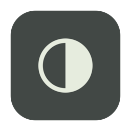
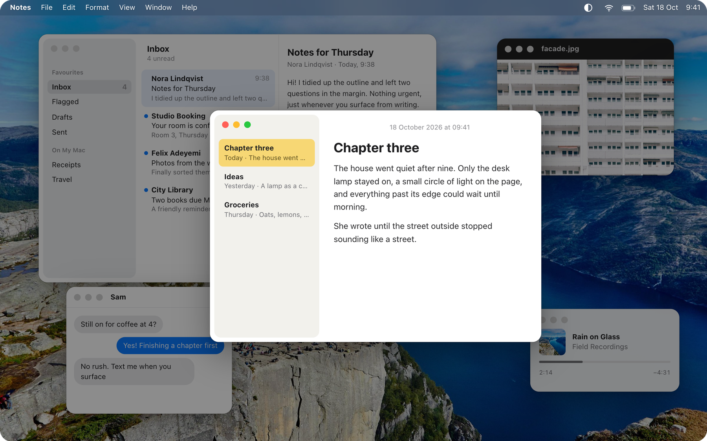
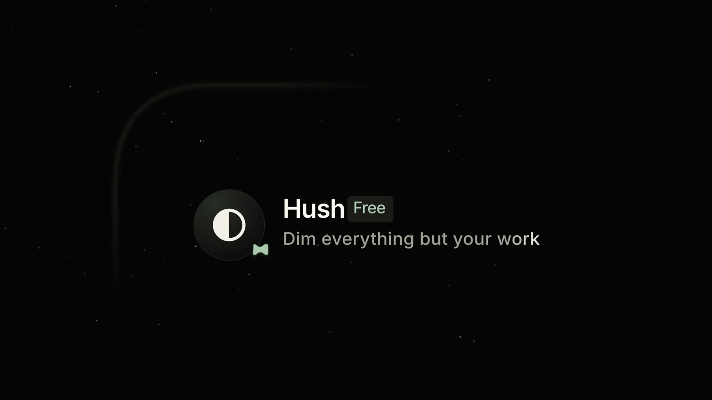
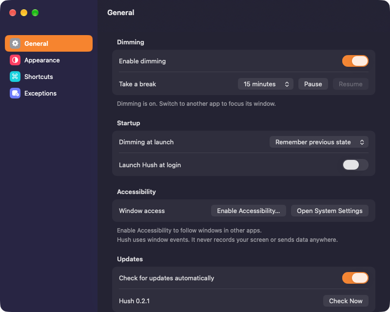
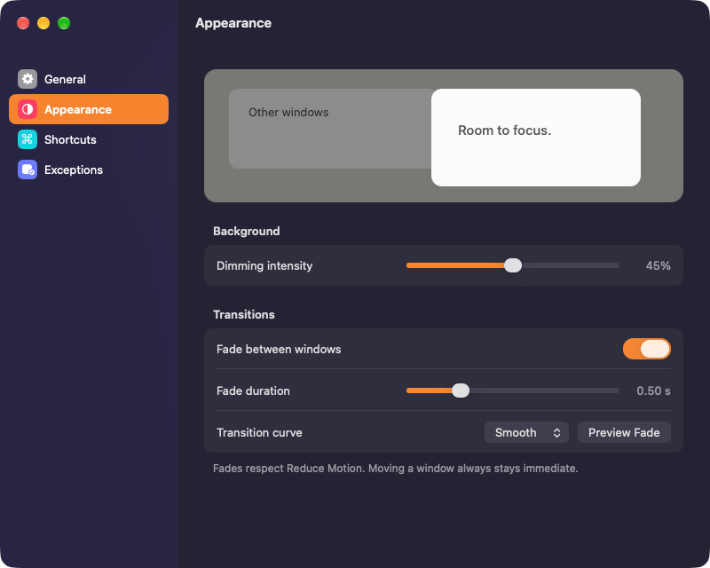
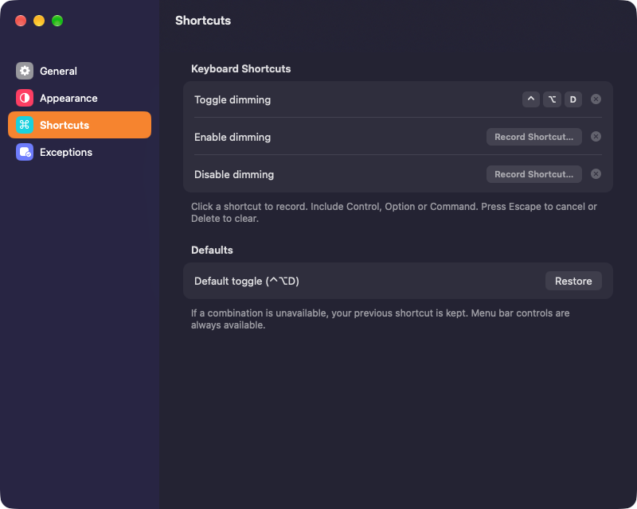
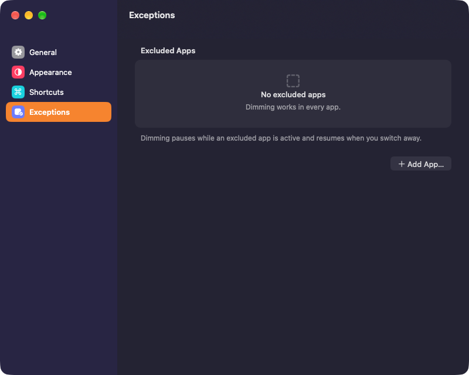

<p align="center">
  
</p>

<h1 align="center">Hush</h1>

<p align="center">
  <b>Dim everything but your work.</b><br>
  A free menu bar app for your Mac that quietly darkens every window except the one you’re using.
</p>

<p align="center">
  <a href="https://github.com/musaAmir/Hush/releases"><b>Download</b></a> ·
  <a href="https://musaamir.github.io/Hush/"><b>Website</b></a> ·
  macOS 14+ · Apple silicon &amp; Intel
</p>

<p align="center">
  
</p>

<p align="center"><sub>Try it live on the <a href="https://musaamir.github.io/Hush/">website</a>: click any window, or the Hush icon in the menu bar.</sub></p>

<p align="center">
  <a href="https://musaamir.github.io/Hush/#film"></a><br>
  <sub><a href="https://musaamir.github.io/Hush/#film">▶ Watch the 25-second launch film</a></sub>
</p>

## Features

- **Focus on one window.** Everything behind the window you’re using dims, on every display. Switching windows fades only the one you leave.
- **As dark and as soft as you like.** Dimming from 5% to 85%, with fades from 0.05 to 2 seconds or none at all. Respects Reduce Motion.
- **Keyboard shortcuts.** Toggle with <kbd>⌃</kbd> <kbd>⌥</kbd> <kbd>D</kbd>, or record your own for toggling, enabling and disabling.
- **Take a break.** Pause for 5 minutes, 15 minutes or an hour from the menu bar or Settings.
- **App exceptions.** Dimming pauses while apps like Keynote or Zoom are in front.
- **Stays out of the way.** Lives in the menu bar, launches at login if you want, and only shows a Dock icon while Settings is open.
- **Updates itself.** New versions arrive from GitHub releases inside the app.

## Settings

<table>
  <tr>
    <td></td>
    <td></td>
  </tr>
  <tr>
    <td></td>
    <td></td>
  </tr>
</table>

## Install

1. Download the ZIP from [Releases](https://github.com/musaAmir/Hush/releases), unzip it and move **Hush.app** to **Applications**.
2. Open Hush. It isn’t notarized by Apple yet, so the first time macOS asks you to choose **Open Anyway** in **System Settings → Privacy & Security**.
3. Turn Hush on under **System Settings → Privacy & Security → Accessibility**.

Hush only follows which window is in front. It doesn’t record your screen, has no account and collects no analytics. The only network request is the daily update check, which you can turn off.

## Build

Requires Xcode with Swift 5.9 or newer.

```sh
swift test
./build.sh universal
```

[Release script](scripts/release.sh) · [Testing notes](docs/testing.md) · [Website source](website/hush)
